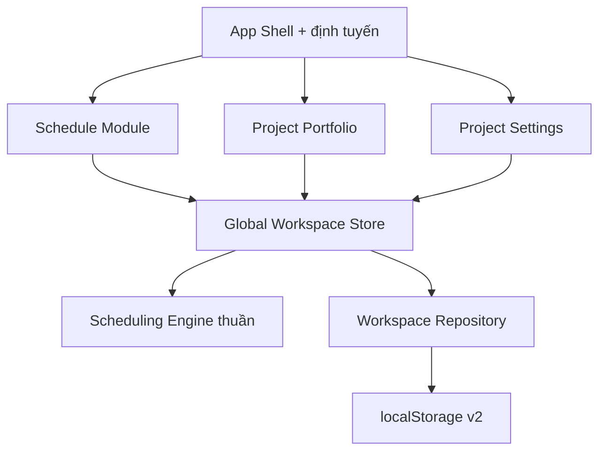

# Kiến trúc mở rộng — Phase 1

## 1. Phân tích bản ZIP đầu vào

ZIP nguồn: `ForgePlan_Engineering_Planner_Source_v1_1.zip`.
SHA-256: `a760c2f52af7f2c571e75637c3db16e24bbafc19315bf1505bb03fca008e9e40`.

Bản trước gồm một workspace React lớn, một Zustand store đơn dự án, một scheduling engine thuần, kiểu dữ liệu và dữ liệu mẫu. UI đã có nhiều thao tác nghiệp vụ hoạt động: inline edit, dependencies, drag/resize có preview, baseline, undo/redo, import/export JSON và virtualization. Mục tiêu của Phase 1 là đổi ranh giới kiến trúc, không thay engine bằng bản viết lại.

## 2. Sơ đồ kiến trúc hiện hành



Các phân hệ Resources, Execution, Dashboard và Data được đăng ký trong `app/moduleRegistry.ts`. Phase 1 có route, shell và trạng thái chưa triển khai cho chúng. Chỉ thêm màn hình thật khi đến Phase 3/4; không tạo bảng giả có vẻ đang vận hành.

## 3. Đường dẫn và trách nhiệm

| Thành phần | File/Thư mục | Trách nhiệm |
| --- | --- | --- |
| Entrypoint | `src/main.tsx` | Mount App và styles |
| Shell | `src/app/App.tsx` | Sidebar, context header, view switcher, lazy module, error boundary |
| Routing | `src/app/useWorkspaceRouter.ts` | URL hash, back/reload, kiểm tra project ID tồn tại |
| Registry | `src/app/moduleRegistry.ts` | Nhãn, icon, route và phase của các phân hệ |
| Domain | `src/domain/project.ts`, `workspace.ts` | Types nghiệp vụ; thông tin hợp đồng/client là trường tùy chọn tương thích dữ liệu cũ |
| Global Store | `src/store/workspaceStore.ts` | Map dự án, active ID, route, trạng thái lưu, tạo/chuyển dự án, settings |
| Adapter hook | `src/store/useProjectStore.ts` | Cho UI tiến độ đọc đúng record đang hoạt động; không tạo store thứ hai |
| Derived selectors | `src/store/selectors.ts` | Tiến độ/số task/baseline từ dữ liệu chung |
| Schedule session | `modules/schedule/model/createScheduleSession.ts` | Lệnh chỉnh task và lịch sử theo đúng project ID |
| Engine | `modules/schedule/engine/schedulingEngine.ts` | Tính lịch/CPM/tải nguồn lực, nguyên bản |
| UI tiến độ | `modules/schedule/components/ScheduleWorkspace.tsx` | Renderer Tree Grid/Gantt và thao tác hiện hữu |
| Shared tokens | `src/shared/styles/tokens.css`, `designTokens.ts` | Màu/font và kích thước dùng chung CSS + JavaScript |
| Repository | `src/infrastructure/persistence/workspaceRepository.ts` | Tách storage ra khỏi nghiệp vụ; migration và serialization |

## 4. Single Source of Truth

Runtime state:

```typescript
WorkspaceState {
  projects: Record<ProjectId, ScheduleSession>;
  projectOrder: ProjectId[];
  activeProjectId: ProjectId;
  view: WorkspaceView;
  sidebarCollapsed: boolean;
  persistenceError: string;
}
ScheduleSession {
  project: ProjectInput;       // nguồn dữ liệu nghiệp vụ
  result: ScheduleResult;      // cache dẫn xuất từ engine
  baseline: Baseline | null;
  selected: TaskId[];
  collapsed: Set<TaskId>;
  history: Snapshot[];
  future: Snapshot[];
  revision: number;
  // các lệnh chỉnh sửa bound vào project ID của record
}
```

`result` được tính lại cùng giao dịch chỉnh input, không phải một bản input thứ hai. Portfolio và Schedule dùng chung selector tiến độ; các module tương lai phải dùng cùng record/actions, không giữ một danh sách task cục bộ khác.

Luồng sửa: clone input → áp dụng thay đổi → validate/tính lịch → thay project/result cùng lần set → các view subscribe cập nhật ngay → repository lưu dữ liệu. Tính lịch lỗi thì input/result cũ giữ nguyên. Lỗi storage được báo riêng và thay đổi vẫn còn trong bộ nhớ.

History/future được cô lập trong từng project. Chuyển active ID không gọi `replace()` lên dự án cũ. Component tiến độ có key theo project ID để drawer hoặc thao tác kéo đang mở không ghi sang một dự án khác.

Import JSON chỉ thay nội dung dự án đang chọn, giữ ID workspace; input và baseline mới được commit cùng lần set. Các dự án khác không bị tác động. Không coi đây là import portfolio nhiều dự án; chức năng đó thuộc Phase 4.

## 5. Lưu trữ và tương thích ngược

Envelope lưu trữ `WorkspaceDocument` có `schemaVersion: 2`, active ID, view, sidebarCollapsed và mảng snapshot `{project, baseline}`. `ScheduleResult`, function, Set, selection, history, future không được serialize. Reload tính lại result bằng engine.

Khi v2 chưa tồn tại, adapter đọc khóa v1 rồi migrate. Khóa v1 không bị xóa hoặc ghi đè. Dữ liệu v2 lỗi không bị thay tự động bằng sample: phiên tạm bật cờ chặn persistence để bảo vệ dữ liệu cần phục hồi.

Repository Phase 1 là synchronous vì tiếp nối localStorage. Phase 4 chuyển adapter sang IndexedDB/REST với bootstrap async, trạng thái hydration, optimistic concurrency và error/retry. Không tuyên bố adapter synchronous này đã là backend/API hoàn chỉnh.

## 6. Design System

| Token | Giá trị |
| --- | --- |
| Canvas / surface | #F8FAFC / #FFFFFF |
| Text / secondary | #0F172A / #475569 |
| Border | #E2E8F0, 1px |
| Normal / critical | #4F46E5 / #E11D48 |
| Accepted / danger | #059669 / #DC2626 |
| Hover / selection | #EEF2FF / #E0E7FF |
| Body / numeric font | Inter 13px / JetBrains Mono 12px, tabular-nums; system fallback |
| Row / timeline header | 36px / 56px |
| App header / ribbon | 48px / 48px |
| Sidebar | 208px expanded / 56px collapsed |
| Gantt | 20px container, main Physical fill + 3px Duration indicator, radius 6px |

Các giá trị hình học có nguồn JavaScript tại `shared/designTokens.ts`, cấp thành CSS variables lên Shell. Bảng danh mục và bảng WBS đều dùng chiều cao chuẩn 36px. Thanh Gantt giữ vị trí/thời lượng thật. Cross-pane hover dùng một row/task ID.

## 7. Những điều cố ý không thay trong Phase 1

- Nội dung file engine không đổi. FS/SS/FF/SF, lead/lag, lịch, CPM, roll-up và tải nguồn lực giữ hành vi đã kiểm thử.
- Giữ một baseline đang hoạt động; đa baseline thuộc Phase 2.
- Giữ roll-up theo duration hiện hữu. Trọng số cố định theo công sức/điểm khối lượng thuộc Phase 2; tuyệt đối không dùng Physical % làm trọng số của chính nó.
- Duration % hiện có là tỷ lệ thời gian kế hoạch đã trôi qua; không gọi đó là actual duration progress.
- Resource types hiện có là engineer/equipment. Material, danh mục liên dự án và cross-project overload thuộc Phase 3.
- Không thay tự động lịch để xử lý quá tải.
- Không tạo engine/browser rendering mới, không khẳng định 60fps khi chưa profiling.

## 8. Điểm mở rộng cho các phase kế tiếp

Phase 2 mở rộng domain với fixed progress weights, baseline collection + active baseline ID, variance; migration schema phải giữ baseline hiện hữu thành bản đầu tiên. Hoàn thiện WBS/editor qua session actions để mọi module cập nhật cùng dữ liệu.

Phase 3 bổ sung resource pool và execution records liên kết task ID, checklist/acceptance/evidence; mọi tác vụ được nghiệm thu cập nhật cùng task canonical, không fork dữ liệu Kanban.

Phase 4 thêm selectors Dashboard/S-Curve, historical snapshots, multi-sheet Excel/CSV round-trip, IndexedDB async repository và schema/API server. S-Curve Actual cần snapshot tiến độ theo ngày; không suy diễn lịch sử từ một giá trị Physical hiện tại.
